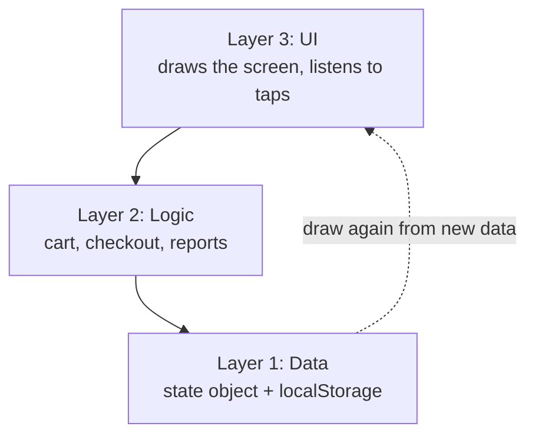

# Tindahan Tracker

A web app for a small store (sari-sari store). It tracks products, stock, sales, expenses, and real profit. It works on a phone browser and keeps its data on the device, so it needs no server or internet after loading.

Made for my Computer Programming final project. Course: BSIT, CCDI.

## What it does

- **Sell:** tap products to build a sale, then tap Complete sale. Stock goes down automatically.
- **Inventory:** add, edit, delete products, and add stock when new items arrive. Items running low are marked.
- **Expenses:** write down money the store spends that is not goods for sale, such as rent, electricity, transport, and wages.
- **Reports:** choose Today, 7 days, Month, or All. It shows sales, gross profit, expenses, **net profit**, items sold, best sellers, low stock, and the list of sales. Sales can be exported as a CSV file for Excel.

## How to use it

1. Open the page.
2. Go to **Inventory** and replace the sample products with your own (name, cost, selling price, stock, and the number at which you want a low-stock warning).
3. Go to **Sell** and tap products as customers buy.
4. Go to **Expenses** and record each bill you pay (rent, electricity, and so on).
5. Check **Reports** at the end of the day or month.

## Files

| File | Job |
| --- | --- |
| `index.html` | The structure: tabs, form, lists |
| `style.css` | How it looks (light and dark mode) |
| `app.js` | All the behavior |

## Architecture

`app.js` has three layers. Each layer only uses the one below it.



What happens when the cashier taps **Complete sale**:

1. The UI click handler calls `checkout()`.
2. `checkout()` checks the cart and the stock, computes the total and profit, reduces each product's stock, and adds a sale record to `state.sales`.
3. `saveState()` writes `state` to `localStorage`.
4. The UI calls `renderAll()`, which redraws every screen from `state`.

### Data model

```text
state.products: [{ id, name, cost, price, stock, reorder }]
state.sales:    [{ id, time, items: [{ name, qty, price, cost }], total, profit }]
state.expenses: [{ id, time, label, amount }]
cart:           { productId: quantity }      (temporary, not saved)
```

Profit for one item is `(price - cost) x qty`. A sale keeps its own copy of the item name, price, and cost. This way old reports stay correct even if a product is edited or deleted later.

### The profit formulas

```text
sales        = what customers paid
gross profit = sales - cost of the goods sold      (price - cost, for each item sold)
net profit   = gross profit - expenses             (rent, electricity, transport, wages)
```

The cost of goods is already inside gross profit, so it must not be added again as an expense. If it were, the profit would be counted too low.

### Design decisions

- **`localStorage` instead of a database.** One store, one device, no server needed. The trade-off is that data stays on that browser only. A later version could use a real database such as Firebase.
- **State then redraw.** The screen is always drawn from `state`, so the screen and the data cannot disagree.
- **`textContent` instead of `innerHTML`.** Product names are typed by the user. `textContent` treats them as plain text, so they cannot inject code into the page.
- **`round2()` for money.** Computers store decimals imprecisely (`0.1 + 0.2` gives `0.30000000000000004`). Rounding to 2 decimals keeps peso amounts clean.
- **Old data keeps working.** Version 1 saved no `expenses`. `loadState()` adds an empty list when it is missing, so a store owner never loses data after an update.
- **Two-step delete and reset.** The first tap changes the button text and the second tap confirms. This prevents accidental loss without using pop-up dialogs.

## Run it

Open `index.html` in a browser. To put it online, upload the files to a GitHub repository and turn on GitHub Pages (Settings, Pages, branch `main`, folder `/ (root)`).

## Ideas for the next version

- Back up and restore data (JSON file)
- Credit ("utang") tracking per customer
- A chart of daily sales and profit
- Barcode scanning with the phone camera
- Online database so several phones share one store

## Questions I can answer about this project

**Why are there three layers?** So each part has one job. I can change how the screen looks without touching the checkout math.

**Where is the data saved?** In the browser's `localStorage`, as text made by `JSON.stringify(state)`. It is loaded again with `JSON.parse` when the page opens.

**What stops a sale when stock is too low?** `addToCart()` blocks adding more than the stock, and `checkout()` checks again before saving.

**What is the difference between gross profit and net profit?** Gross profit only removes the cost of the goods sold. Net profit also removes the expenses of running the store, so it shows if the business really earns money.

**How is low stock found?** `lowStock()` returns every product where `stock <= reorder`.
